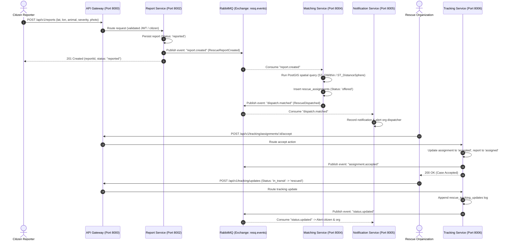
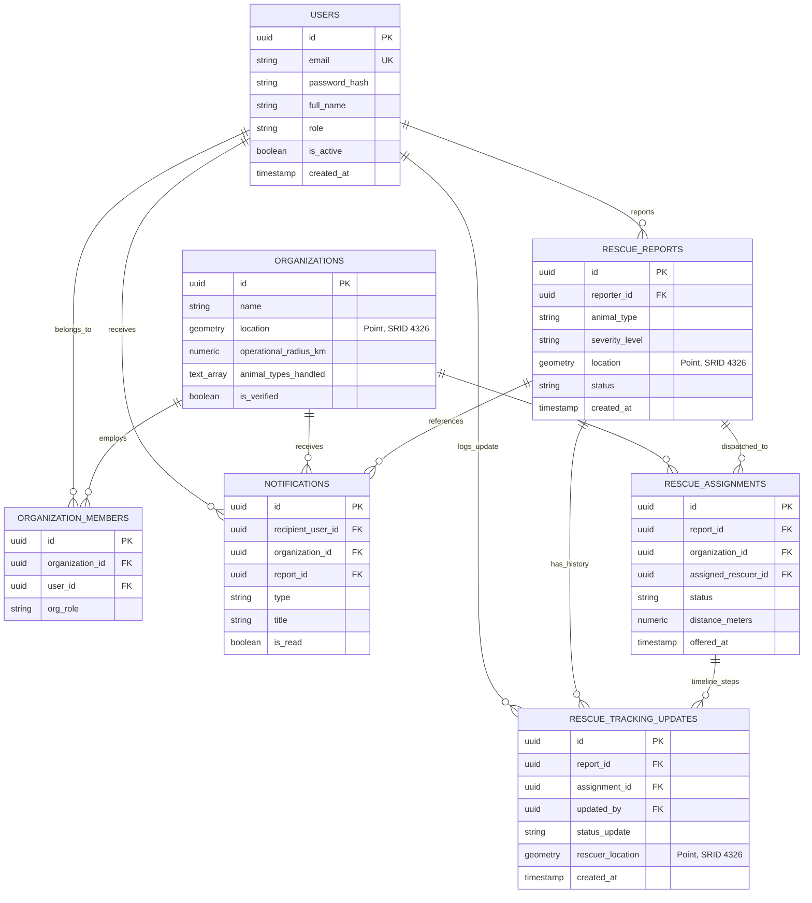

# ResQ — Architecture & System Design Document
## From Distress to Rescue: Backend System Architecture

---

## 1. System Overview & Core Workflow

**ResQ** is a distributed, event-driven backend system engineered to coordinate emergency animal rescue operations. The system connects distress callers (citizens) with vetted animal rescue organizations and field rescuers using spatial proximity matching.

### The Core Flow


---

## 2. Monorepo Directory Structure

A clean, predictable monorepo structure allows the entire system to run seamlessly with a single `docker compose up` while maintaining strict boundary separation between services:

```text
ResQ/
│
├── PROJECT_CONTEXT.md              # Vision, tech stack, evaluation context
├── IMPLEMENTATION_STATUS.md        # 3-Day milestone tracker & checklist
├── docker-compose.yml              # Multi-container orchestration (DB, RabbitMQ, Services)
├── .env.example                    # Global environment variables template
├── .gitignore                      # Node, logs, Docker artifacts ignore list
│
├── database/                       # Database initialization & migrations
│   ├── schema.sql                  # PostgreSQL + PostGIS tables, indexes, seed data
│   └── seed.sql                    # Standalone development seed data
│
├── docs/                           # Architecture, diagrams, API guides
│   ├── architecture.md             # Complete architectural specification (this file)
│   └── api_spec.md                 # Postman / OpenAPI compatible REST guide
│
├── shared/                         # Reusable core modules across microservices
│   ├── package.json
│   ├── config/                     # Shared environment variable loaders
│   ├── db/                         # PostgreSQL connection pool singleton (pg pool)
│   ├── messaging/                  # RabbitMQ channel wrapper, publisher, subscriber
│   ├── middleware/                 # JWT verification middleware, errorHandler
│   └── utils/                      # Logger, response formatter, coordinate validators
│
└── services/                       # Independent Node.js microservices
    ├── api-gateway/                # Reverse proxy, rate limiter, routing, JWT check
    │   ├── package.json
    │   ├── Dockerfile
    │   └── src/
    │       ├── app.js
    │       └── routes/
    │
    ├── auth-service/               # Registration, login, password hashing, token issue
    │   ├── package.json
    │   ├── Dockerfile
    │   └── src/
    │       ├── app.js
    │       ├── controllers/
    │       ├── routes/
    │       └── services/
    │
    ├── report-service/             # Ingestion & management of animal distress reports
    │   ├── package.json
    │   ├── Dockerfile
    │   └── src/
    │       ├── app.js
    │       ├── controllers/
    │       ├── routes/
    │       └── events/             # RabbitMQ publisher for report.created
    │
    ├── organization-service/       # Org registration, onboarding, fleet & radius config
    │   ├── package.json
    │   ├── Dockerfile
    │   └── src/
    │       ├── app.js
    │       ├── controllers/
    │       └── routes/
    │
    ├── matching-service/           # Spatial proximity matching engine (Worker / Service)
    │   ├── package.json
    │   ├── Dockerfile
    │   └── src/
    │       ├── app.js
    │       ├── engine/             # PostGIS ST_DWithin spatial queries
    │       └── consumers/          # RabbitMQ consumer for report.created
    │
    ├── notification-service/       # Notification delivery & in-app alerts (Worker / API)
    │   ├── package.json
    │   ├── Dockerfile
    │   └── src/
    │       ├── app.js
    │       ├── consumers/          # Listens to dispatch.matched, status.updated
    │       └── routes/             # GET /notifications for user inbox
    │
    └── tracking-service/           # Case acceptance, dispatch workflow, audit timeline
        ├── package.json
        ├── Dockerfile
        └── src/
            ├── app.js
            ├── controllers/
            ├── routes/
            └── events/             # Publishes assignment.accepted, status.updated
```

---

## 3. Microservices Responsibilities & Port Mapping

| Service Name | Port | Status | Primary Responsibility | Consumes Events | Produces Events | Tables Accessed |
| :--- | :--- | :--- | :--- | :--- | :--- | :--- |
| **API Gateway** | `8000` | ✅ **Implemented & Verified** | Single entry-point, reverse proxy (`pathFilter`), CORS, error normalization | None | None | None (stateless proxy) |
| **Auth Service** | `8001` | ⏳ *Planned* | User registration, login, bcrypt password verification, JWT generation | None | None | `users` |
| **Report Service** | `8002` | ✅ **Implemented & Verified** | Distress report ingestion, PostGIS point conversion (`ST_SetSRID`), spatial retrieval | None | `report.created` | `rescue_reports` |
| **Organization Service** | `8003` | ✅ **Implemented & Verified** | Shelter registration, proximity search (`ST_Distance`, `ST_DWithin`), profile queries | None | None | `organizations` |
| **Matching Service** | `8004` | ⏳ *Planned* | Spatial matching worker. Executes PostGIS spatial queries to find nearest shelters | `report.created` | `dispatch.matched` | `rescue_reports`, `organizations`, `rescue_assignments` |
| **Notification Service** | `8005` | ✅ **Implemented & Verified** | Event consumer for `report.created`, notification persistence, in-app inbox queries | `report.created` | None | `notifications` |
| **Rescue Tracking Service** | `8006` | ⏳ *Planned* | Case acceptance workflow, field rescuer updates, immutable audit trail | None | `assignment.accepted`, `status.updated` | `rescue_assignments`, `rescue_reports`, `rescue_tracking_updates` |

---

## 4. Database Schema Relationships & PostGIS Spatial Mechanics

### Entity-Relationship Diagram (ERD)



### Understanding PostGIS in Simple Terms
1. **What is SRID 4326?**
   - The Earth is not flat. SRID 4326 corresponds to the **WGS 84** standard coordinate reference system used by GPS satellites and Google Maps. Coordinates are represented as `Point(longitude, latitude)`.
   - **Crucial Rule**: In standard GIS SQL, coordinates are ordered `(longitude, latitude)`, NOT `(latitude, longitude)`.

2. **How Proximity Matching Works (`ST_DWithin` & Spatial Distance)**
   When a report comes in at `(report_lon, report_lat)` for a `dog`:
   ```sql
   SELECT 
       org.id AS organization_id,
       org.name,
       org.contact_phone,
       -- Calculate real-world geodesic distance in meters:
       ST_Distance(
           org.location::geography, 
           rep.location::geography
       ) AS distance_meters
   FROM organizations org, rescue_reports rep
   WHERE rep.id = $1
     AND org.is_active = TRUE
     AND org.is_verified = TRUE
     AND rep.animal_type = ANY(org.animal_types_handled)
     -- ST_DWithin tests if distance between two geography points is <= radius in meters
     AND ST_DWithin(
         org.location::geography, 
         rep.location::geography, 
         org.operational_radius_km * 1000
     )
   ORDER BY distance_meters ASC
   LIMIT 5;
   ```
3. **Why GiST Indexing (`idx_organizations_location`) Matters:**
   - Instead of scanning every single row in the database table (a costly $O(N)$ full table scan), a **GiST (Generalized Search Tree)** index structures geospatial bounding boxes. The database prunes 99% of candidate organizations in $O(\log N)$ time before evaluating exact distances.

---

## 5. Essential REST API Endpoints Specification

All external requests pass through **API Gateway** on port `8000` (`http://localhost:8000/api/v1/...`).

### 1. Authentication Service (`/api/v1/auth`)
| Method | Route | Description | Auth Required | Request Payload Summary |
| :--- | :--- | :--- | :--- | :--- |
| `POST` | `/api/v1/auth/register` | Register new user (citizen, rescuer, org_admin) | Public | `{ email, password, full_name, phone, role }` |
| `POST` | `/api/v1/auth/login` | Authenticate and obtain JWT token | Public | `{ email, password }` |
| `GET` | `/api/v1/auth/me` | Fetch authenticated user profile & active role | Bearer JWT | None |

### 2. Report Service (`/api/v1/reports`)
| Method | Route | Description | Auth Required | Request Payload Summary |
| :--- | :--- | :--- | :--- | :--- |
| `POST` | `/api/v1/reports` | Submit a new animal distress report | Optional / Citizen | `{ animal_type, breed, condition_description, severity_level, latitude, longitude, address_text, photo_url }` |
| `GET` | `/api/v1/reports` | List reports (supports `?status=&animal_type=`) | Any Authenticated | Query Params: `status, limit, offset` |
| `GET` | `/api/v1/reports/:id` | Get detailed distress report | Any Authenticated | Path Param: `:id` |

### 3. Organization Service (`/api/v1/organizations`)
| Method | Route | Description | Auth Required | Request Payload Summary |
| :--- | :--- | :--- | :--- | :--- |
| `POST` | `/api/v1/organizations` | Register new rescue organization | Admin / Org Admin | `{ name, contact_email, contact_phone, address_text, latitude, longitude, operational_radius_km, animal_types_handled }` |
| `GET` | `/api/v1/organizations` | List organizations (with optional distance filter) | Public | Query: `lat, lon, radius_km` |
| `GET` | `/api/v1/organizations/:id`| Get organization details | Public | Path Param: `:id` |

### 4. Rescue Tracking Service (`/api/v1/tracking`)
| Method | Route | Description | Auth Required | Request Payload Summary |
| :--- | :--- | :--- | :--- | :--- |
| `GET` | `/api/v1/tracking/assignments` | List pending / active assignments for current org | Org Admin / Rescuer | Query: `status` |
| `POST` | `/api/v1/tracking/assignments/:id/accept` | Accept an offered rescue dispatch | Org Admin / Rescuer | `{ notes }` |
| `POST` | `/api/v1/tracking/assignments/:id/reject` | Reject an offered rescue dispatch | Org Admin | `{ reason }` |
| `POST` | `/api/v1/tracking/reports/:reportId/updates` | Post status update (`in_transit`, `rescued`, etc.) | Org Admin / Rescuer | `{ status_update, notes, latitude, longitude }` |
| `GET` | `/api/v1/tracking/reports/:reportId/timeline` | Fetch full audit trail of rescue actions | Any Authenticated | Path Param: `:reportId` |

### 5. Notification Service (`/api/v1/notifications`)
| Method | Route | Description | Auth Required | Request Payload Summary |
| :--- | :--- | :--- | :--- | :--- |
| `GET` | `/api/v1/notifications` | Fetch unread notifications for logged-in user / org | Bearer JWT | Query: `is_read=false` |
| `PATCH`| `/api/v1/notifications/:id/read` | Mark notification as read | Bearer JWT | Path Param: `:id` |

---

## 6. Event-Driven Messaging Specification (RabbitMQ)

### Topology Configuration
- **Exchange Name**: `resq.events`
- **Exchange Type**: `topic`
- **Durable**: `true` (Survives broker restart)

### Routing Keys & Consumer Queues

| Event Name | Routing Key | Consumed By Queue | Consumer Service | Payload Fields |
| :--- | :--- | :--- | :--- | :--- |
| `RescueReportCreated` | `report.created` | `q.matching.report_created` | Matching Service | `reportId, animalType, severityLevel, latitude, longitude, createdAt` |
| `RescueDispatched` | `dispatch.matched` | `q.notification.dispatch_matched` | Notification Service | `reportId, organizationId, distanceMeters, severityLevel` |
| `RescueAssignmentAccepted` | `assignment.accepted` | `q.notification.assignment_accepted` | Notification Service | `assignmentId, reportId, organizationId, acceptedAt` |
| `RescueStatusUpdated` | `status.updated` | `q.notification.status_updated` | Notification Service | `reportId, previousStatus, newStatus, updatedBy, notes` |

### Sample Payload: `report.created`
```json
{
  "eventId": "e9b25f61-2679-4d45-8c70-13f619b06d4e",
  "eventType": "RescueReportCreated",
  "timestamp": "2026-11-02T14:30:00.000Z",
  "data": {
    "reportId": "99999999-9999-9999-9999-999999999999",
    "reporterId": "44444444-4444-4444-4444-444444444444",
    "animalType": "dog",
    "severityLevel": "medium",
    "location": {
      "latitude": 28.5710,
      "longitude": 77.2280
    },
    "addressText": "Near Moolchand Metro Station, Ring Road, New Delhi"
  }
}
```

---

## 7. Beginner-Friendly Architectural Explanations (CSE Context)

### 1. Why a Monorepo instead of Multiple Git Repositories?
> **Student Context**: In 3rd year CSE, managing 7 separate GitHub repositories means 7 sets of `npm install`, 7 git remotes, and complicated local linking. A monorepo lets your team review all code in one place, share common DB and messaging libraries under `shared/`, and start the entire backend with one `docker compose up`.

### 2. Why One PostgreSQL Database Instance with PostGIS?
> **Student Context**: Pure microservice dogma advocates "Database-Per-Service" (each service having its own database server). In a student project running on a laptop or free-tier cloud instance, running 6 separate PostgreSQL containers will exhaust RAM and CPU. Instead, we use **one high-performance PostgreSQL instance**, with each microservice strictly accessing its own tables. This gives the exact same architectural isolation with a fraction of the hardware footprint.

### 3. Why RabbitMQ instead of Synchronous HTTP Calls?
> **Student Context**: If the Report Service had to directly call the Matching Service, which then calls an Email/SMS API, any slowdown or failure in the email provider would cause the citizen's report submission to hang or time out. With RabbitMQ, the Report Service simply drops a message into the queue in 2 milliseconds and returns a success response. The matching and notification workers process the work asynchronously in the background. If a worker crashes, messages wait safely in the queue until it restarts.

### 4. Why PostGIS instead of JavaScript Math (Haversine Formula)?
> **Student Context**: Writing a `for` loop in JavaScript to calculate distance for 1,000 shelters using the Haversine formula requires pulling 1,000 rows into memory on every report. PostGIS uses compiled C code and **spatial R-Tree / GiST indexes** directly on the disk, finding candidate organizations in 1 to 2 milliseconds even with millions of records.

---

## 8. Pragmatic 3-Day Implementation Roadmap

```
Day 1: Infrastructure, Shared Modules & Ingestion Services (Auth + Report)
Day 2: Spatial Engine, RabbitMQ Event Bus & Matching Pipeline
Day 3: Dispatch Workflow, Live Tracking, Notification & Examiner Demo Run
```

### Day 1: Foundation & Ingestion
- [ ] Spin up Docker Compose with PostgreSQL 16 (PostGIS) and RabbitMQ 3.
- [ ] Apply `database/schema.sql` and verify seed data.
- [ ] Implement `shared/db` (pg pool) and `shared/middleware/auth.js` (JWT).
- [ ] Implement **API Gateway** (reverse proxy routes).
- [ ] Implement **Auth Service** (`POST /register`, `POST /login`).
- [ ] Implement **Report Service** (`POST /reports`, `GET /reports`).

### Day 2: Spatial Matching & Messaging Bus
- [ ] Implement `shared/messaging/rabbitmq.js` (connection & channel management).
- [ ] Wire Report Service to publish `report.created` to `resq.events`.
- [ ] Implement **Matching Service** consumer:
  - Listens to `report.created`.
  - Executes PostGIS `ST_DWithin` spatial query to find nearby shelters.
  - Inserts dispatch records into `rescue_assignments`.
  - Publishes `dispatch.matched`.
- [ ] Implement **Organization Service** (`POST /organizations`, `GET /organizations`).

### Day 3: Case Tracking, Notification & Full Demo
- [ ] Implement **Rescue Tracking Service**:
  - Accept/reject assignment (`POST /tracking/assignments/:id/accept`).
  - Update status (`POST /tracking/reports/:reportId/updates`).
  - Audit trail query (`GET /tracking/reports/:reportId/timeline`).
- [ ] Implement **Notification Service** consumer (persists in-app notifications).
- [ ] Perform end-to-end testing via Postman / curl:
  - Create report $\rightarrow$ inspect RabbitMQ queue $\rightarrow$ verify matching assignment $\rightarrow$ accept case $\rightarrow$ update status to rescued.
- [ ] Prepare demo script and presentation slides for the professor.
